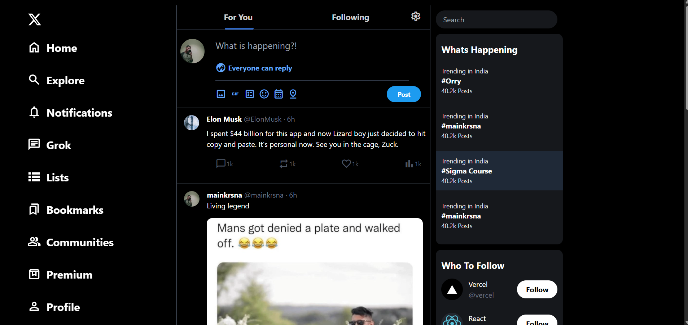
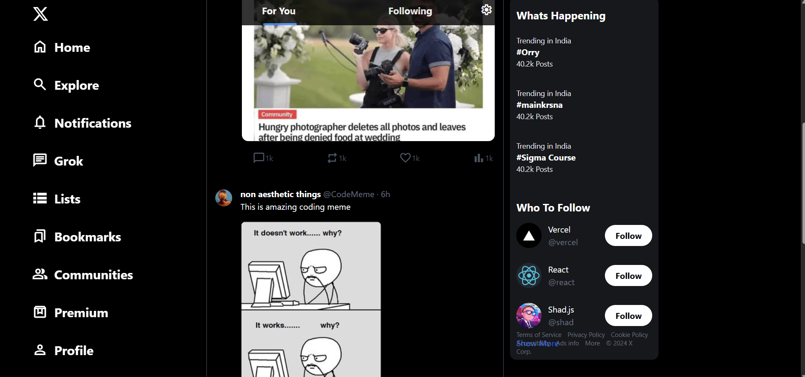
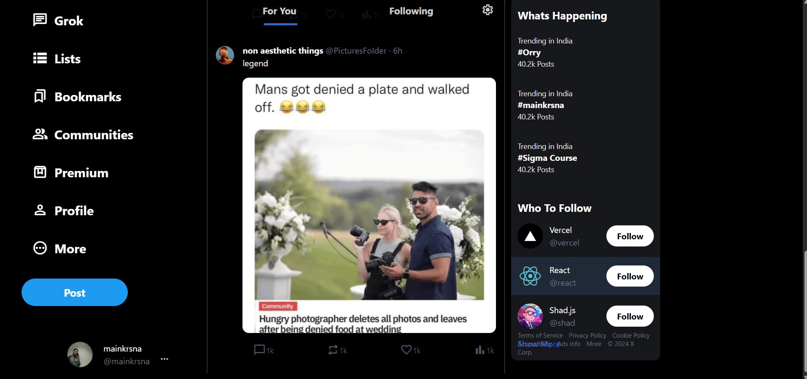

# Twitter / X Clone

A frontend recreation of the Twitter (X) home feed, built with HTML and Tailwind CSS.

## Live Demo

**[View Live Demo](https://mainkrsna-dot.github.io/twitter-clone/)**

> GitHub Pages must be enabled for this link to work. In the repository, open **Settings → Pages**, select **Deploy from a branch**, choose **main** and **/(root)**, then save.

## Screenshots

### Home feed — top


### Home feed — timeline


### Home feed — lower section


## Tech Stack

- HTML5
- Tailwind CSS
- npm for project tooling

## Run Locally

1. Clone the repository:
   ```bash
   git clone https://github.com/mainkrsna-dot/twitter-clone.git
   cd twitter-clone
   ```
2. Install dependencies:
   ```bash
   npm install
   ```
3. Check `package.json` for the available scripts, then run the development/build script listed there.

## Project Scope

This project recreates the visual layout of the X home page, including the navigation sidebar, feed, post composer, trending section, and follow suggestions. It is a frontend UI project; backend-driven actions such as publishing posts or following accounts are not connected.

## Author

**Krishna Prajapati**
